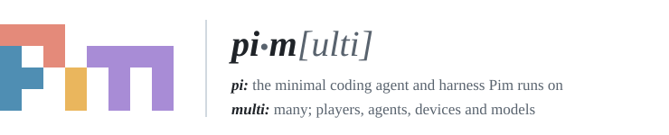
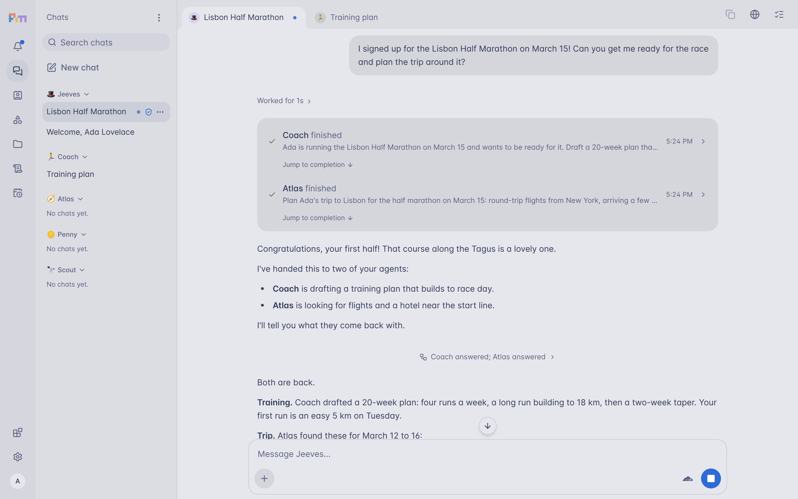
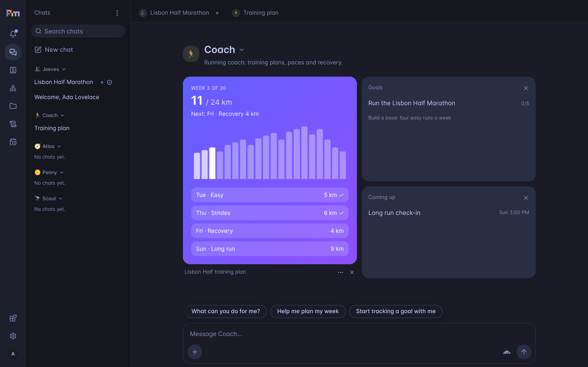
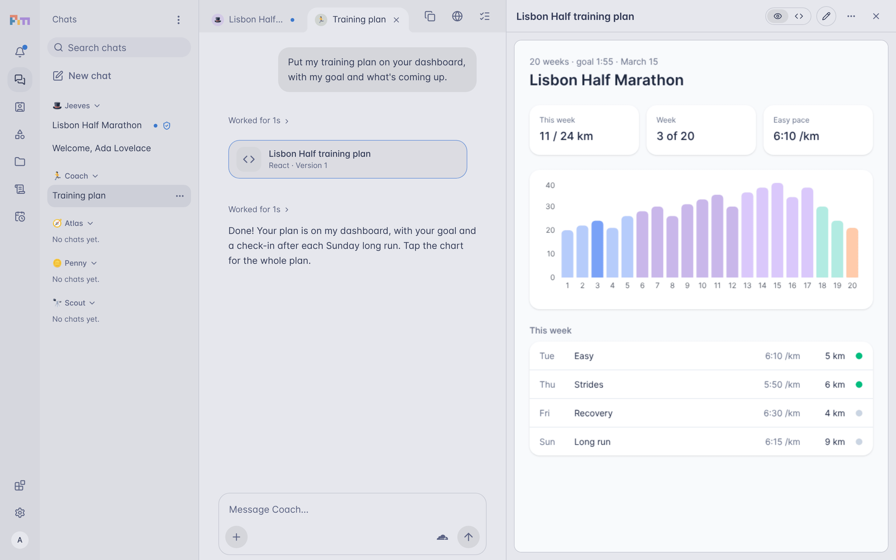
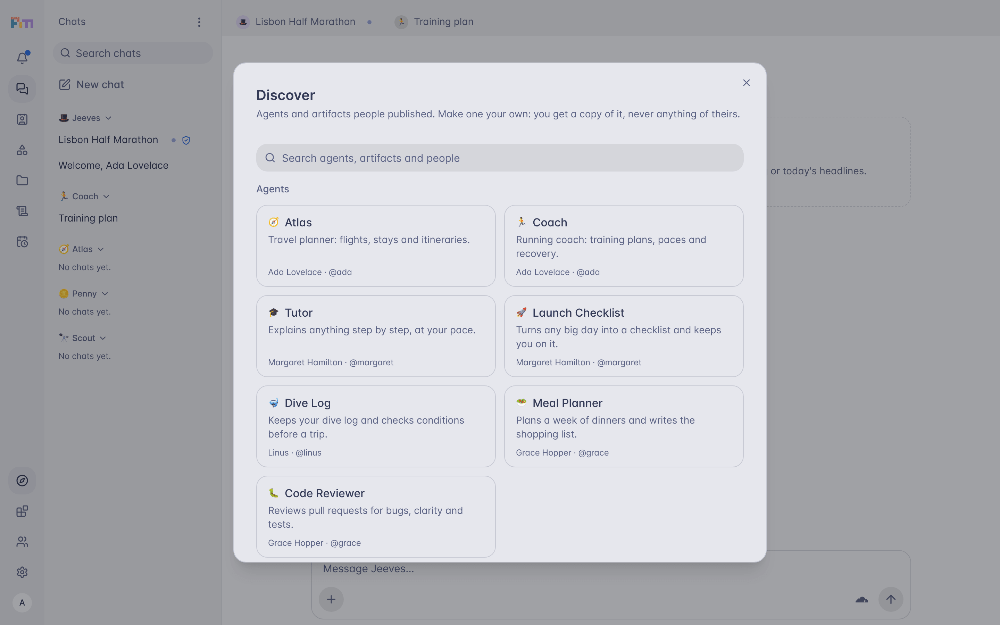
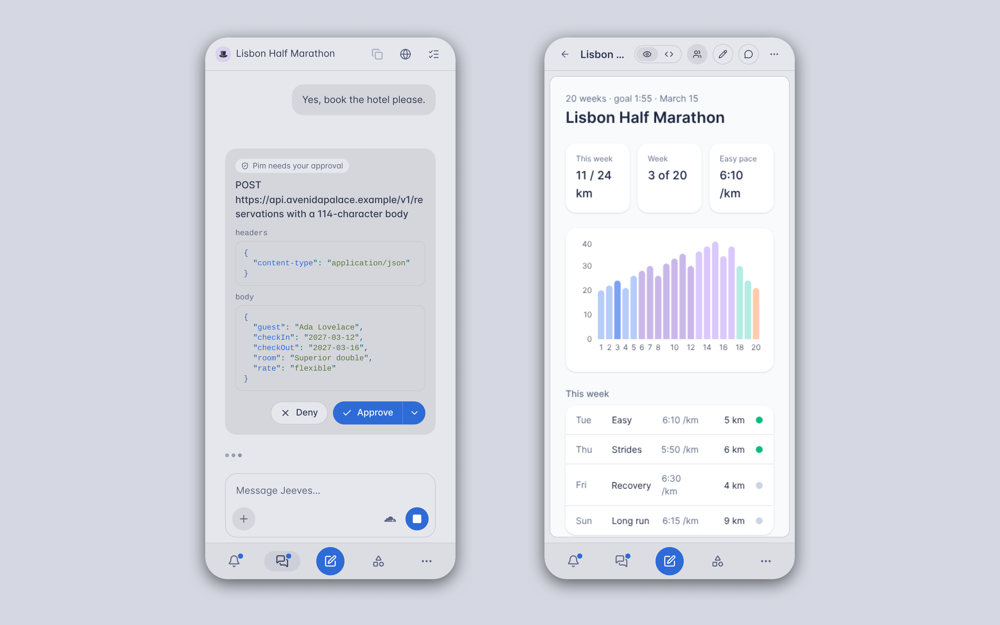

  <picture>
    <source media="(prefers-color-scheme: dark)" srcset="docs/images/header-dark.svg">
    
  </picture>

<b>Self-hosted personal agents platform.</b>

  

Pim is an open-source home for personal agents that you run yourself. Each person on it gets a space of their own, with agents that remember what matters to them, turn goals into plans, keep working in the background, and ask before acting on the world. Run one for yourself, your family, your friends or a small team; their conversations, memories and files stay on infrastructure you control.

## The name

Pim is [pi](https://github.com/earendil-works/pi), the agent harness it runs on, plus **m** for **multi**:

- **Multiplayer.** One Pim serves everyone you invite. Each person has a private space, can let others talk to their agents through circles, and publishes agents and artifacts for the others to find.
- **Multiagent.** You talk with your majordomo, which hands work to your other agents and tells you what came back. Any agent can hand work to its contacts, others of your agents, working at once. Mention an agent as @Coach and it joins the chat, which becomes a group chat with you and your agents.
- **Multidevice.** Use it on desktop or phone, with push notifications. Agents work on a computer you connect, bots use the API, and Claude, ChatGPT and other MCP clients can talk with your majordomo.
- **Multimodel.** Bring the models you want, hosted or local (see [Models](#models)).

## What your agents do

- **Remember.** Long-term memory, after [OptMem](https://github.com/VictorTaelin/OptMem), in scopes: your majordomo knows everything, each other agent what you let it, and you can make any of it forget.
- **Plan and follow up.** Goals with step-by-step plans, reminders and recurring work on a schedule.
- **Make things.** Documents, pages and small React apps, kept with every version, which can sit on an agent's dashboard as widgets.
- **Use your apps and your computer.** GitHub, Linear, Notion and more than 30 other apps over MCP; commands and a browser on a machine of yours.
- **Ask first.** Anything that acts on the world, such as a request, a command or a click, waits for your approval unless you allowed it.

## Screenshots

<table>
  <tr>
    <td width="50%"> Each agent's dashboard holds what you asked it to show.</td>
    <td width="50%"> Artifacts open beside the chat.</td>
  </tr>
  <tr>
    <td width="50%"> Discover lists what people on your Pim published.</td>
    <td width="50%"> On a phone: an approval, and an artifact.</td>
  </tr>
</table>

## Self-host it

Pim is one server application, written to the Workers and Durable Objects APIs: a Worker that serves everyone, and a Durable Object with its own database for each person's space.

- **Today, on Cloudflare.** The easiest and best supported path: deploy it to your own Cloudflare account in a few clicks.

  

- **Next, anywhere.** The aim is a Pim that runs entirely off Cloudflare: on your own machines with [celld](https://celld.dev), which runs the same APIs, keeping its state in any S3-compatible bucket, with the models of your choice.

To try it on your machine first, `pnpm install && pnpm preview` starts a Pim at `http://localhost:8787` with a stand-in model, to look around without a Cloudflare account.

## Models

Each person picks the model for their chats, from those the Pim offers:

- **Workers AI**, the default on Cloudflare, and any model in AI Gateway's catalog
- **Your ChatGPT plan** (Plus or Pro), with its included usage
- **Anthropic, OpenAI, Google Gemini, OpenRouter, DeepSeek, Mistral AI, Groq and xAI**, with an API key
- **Local models** on llama.cpp, LM Studio, Ollama or vLLM, and any other server that speaks OpenAI's chat completions

A Pim on Cloudflare can reach only servers on the public internet; one on your own machines can reach the models running beside it.

## Learn more

- [How Pim works](docs/reference.md): deploying, the API, memory, models, apps, agents and sharing
- [Running a Pim for several people](docs/instance.md)
- [Artifacts](docs/artifacts.md) and [extensions](docs/extensions.md)

To work on Pim, `pnpm check` runs the type checks, lint and tests, as CI does.

Pim is released under the [Functional Source License, Version 1.1, ALv2 Future License](LICENSE) (FSL-1.1-ALv2). You can use, modify and self-host Pim for any purpose, including inside a company, except offering it as a competing commercial service. Each release becomes available under the Apache License 2.0 two years after it is published.
