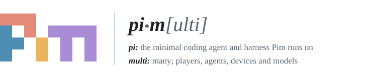
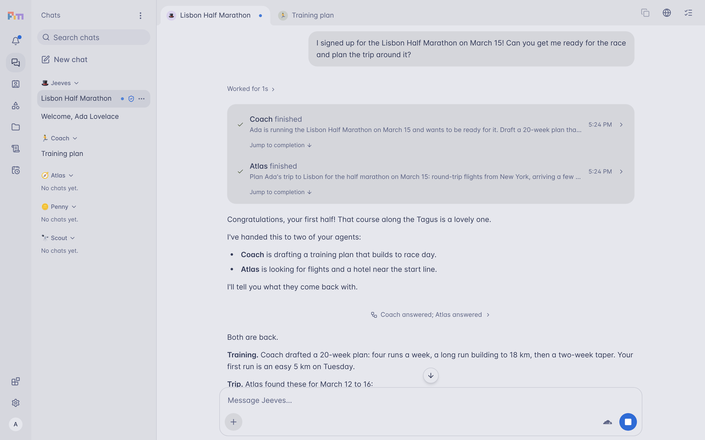
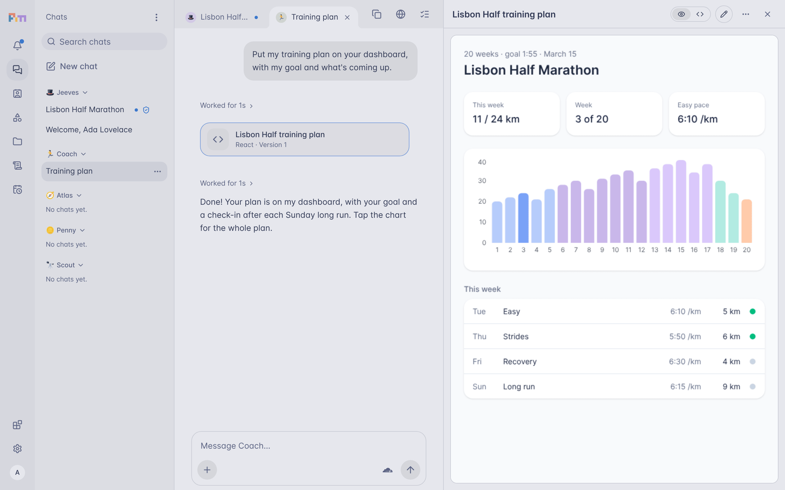
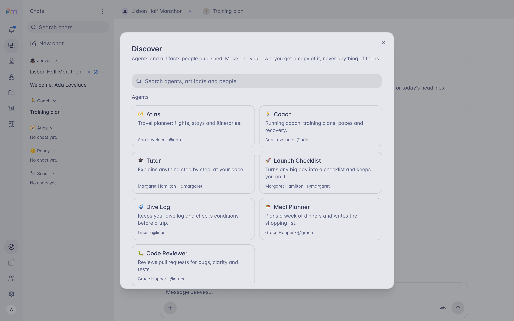
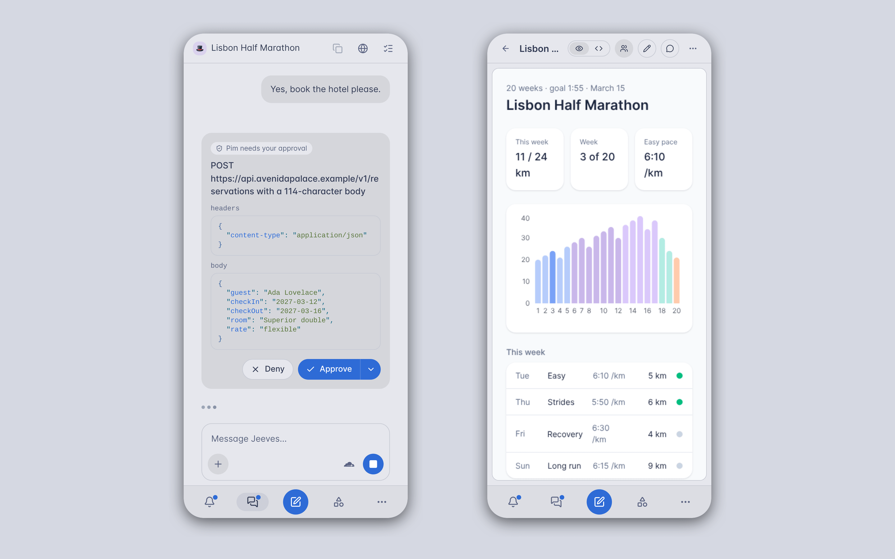

  <picture>
    <source media="(prefers-color-scheme: dark)" srcset="docs/images/header-dark.svg">
    
  </picture>

<b>Self-hosted personal agents platform.</b>

  

Pim is an open-source home for personal agents that you run yourself. Each person on it gets a space of their own, with agents that remember what matters to them, turn goals into plans, keep working in the background, and ask before acting on the world. Run one for yourself, your family, your friends or a small team; their conversations, memories and files stay on infrastructure you control.

## The name

Pim is [pi](https://github.com/earendil-works/pi), the agent harness it runs on, plus **m** for **multi**:

- **Multiplayer.** One Pim serves everyone you invite. Each person has a private space, can let others talk to their agents through circles, and publishes agents and apps for the others to find. The admin can also share an agent as a public bot: anyone with its link signs up as a guest and chats with it, within daily limits on messages and tool calls, using only the tools the admin switches on, which run as the admin.
- **Multiagent.** You talk with your majordomo, which hands work to your other agents and tells you what came back. Any agent can hand work to its contacts, others of your agents, working at once. Every chat is a group chat: add an agent from its "In this chat" menu, or mention it as @Coach, and it joins, until you or the chat's agent take it out again.
- **Multidevice.** Use it on desktop or phone, with push notifications. Agents work on a computer you connect, bots use the API, and Claude, ChatGPT and other MCP clients can talk with your majordomo.
- **Multimodel.** Bring the models you want, hosted or local (see [Models](#models)).

## What your agents do

- **Remember.** Long-term memory, after [OptMem](https://github.com/VictorTaelin/OptMem), in scopes: your majordomo knows everything, each other agent what you let it, and you can make any of it forget.
- **Plan and follow up.** Goals with step-by-step plans, reminders and recurring work on a schedule.
- **Make things.** Notes you and your agents write together, live, with diagrams and drawings in them, and pages and small React apps, each kept with every version: Pim Apps.
- **Use your connectors and your computer.** GitHub, Linear, Notion and more than 30 other connectors over MCP; commands and a browser on a machine of yours, or on an Ubuntu desktop Pim keeps for you, which you use from the app and take over from your agents at any time.
- **Ask first.** Anything that acts on the world, such as a request, a command or a click, waits for your approval unless you allowed it.

## Screenshots

<table>
  <tr>
    <td width="50%"> Apps open beside the chat.</td>
    <td width="50%"> Discover lists what people on your Pim published.</td>
  </tr>
  <tr>
    <td width="50%"> On a phone: an approval, and an app.</td>
    <td width="50%"></td>
  </tr>
</table>

## Self-host it

Pim is one server application, from one container image, on PostgreSQL, NATS and any S3-compatible object store. Each person's space is their own rows in the database, kept apart by row-level security, so one stack serves everyone you invite.

- **Docker Compose**, for a machine at home or a small server: `deploy/compose/init-env.sh https://pim.example.com` writes a `.env` with random secrets and keys, and `deploy/compose/pim.sh up -d --wait` starts the whole stack (Caddy with its own certificate, PostgreSQL, PgBouncer, NATS, SeaweedFS object storage, the migrator and Pim's roles). Updating, backing up and restoring are one command each. See [Running Pim](docs/v2-operations.md#compose-homelab).
- **Kubernetes**, for more: Kustomize manifests with CloudNativePG, a Runner that scales and drains, and Prometheus alerts and a Grafana dashboard. See [Kubernetes](docs/v2-operations.md#kubernetes).

To try it on your machine first, `node scripts/v2-dev/preview.mjs` (after `pnpm install`) starts a Pim at `http://localhost:8787` with a stand-in model and a passkey-free sign-in, on a private PostgreSQL, NATS and S3 server, with no Docker and no account anywhere.

Coming from the Cloudflare version of Pim (the git tag `v1-final`)? [Cutover from the Cloudflare deployment](docs/v2-operations.md#cutover-from-the-cloudflare-deployment) moves everyone's data to the new stack.

## Models

Each person picks the model for their chats, from those the Pim offers:

- **Your ChatGPT plan** (Plus or Pro), with its included usage
- **Anthropic, OpenAI, Google Gemini, OpenRouter, DeepSeek, Mistral AI, Groq and xAI**, with an API key
- **The deployment's own model**, an OpenAI-compatible gateway the admin names in `.env`, shared by everyone
- **Local models** on llama.cpp, LM Studio, Ollama or vLLM, and any other server that speaks OpenAI's chat completions, which Pim reaches from the machine it runs on

## Learn more

- [How Pim works](docs/reference.md): the setup, the API, memory, models, connectors, agents and sharing
- [Running Pim](docs/v2-operations.md): install, update, back up, observe
- [Running a Pim for several people](docs/instance.md)
- [Apps](docs/apps.md) and [what Pim is built from](docs/extensions.md)

To work on Pim, [AGENTS.md](AGENTS.md) describes the repository, and `pnpm check` runs the type checks, lint and tests, as CI does.

Pim is released under the [Functional Source License, Version 1.1, ALv2 Future License](LICENSE) (FSL-1.1-ALv2). You can use, modify and self-host Pim for any purpose, including inside a company, except offering it as a competing commercial service. Each release becomes available under the Apache License 2.0 two years after it is published.
